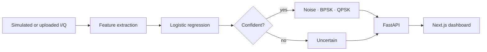

<!-- ═══════════════════════════ HEADER ═══════════════════════════ -->


<div align="center">

[](https://git.io/typing-svg)

<a href="https://www.linkedin.com/in/edward-moon-972007237"></a>
<a href="mailto:sungjune.moon@gmail.com"></a>
<a href="https://github.com/EMoon-03?tab=repositories"></a>

</div>

---

## 👨‍💻 About Me

I'm a Rutgers Computer Science graduate, now a part-time **MSCS student at Stevens Institute of Technology** focusing on **machine learning and AI**.

I like the part of ML that comes *after* the notebook: wrapping models in **APIs, CLIs, and full-stack apps** that people can actually run. Most of what I build is Python, with React and TypeScript when it needs a face.

I've also spent a lot of time teaching code, as a tutor at Rutgers' CS help center and as a Python instructor. That's made me much better at explaining, and documenting, what I build.

> 🎯 **Looking for:** software engineering internships and roles in **applied ML, backend, and AI tooling**.

---

## 🧠 Model Card

<sub>Every good model ships with a model card. So does this one.</sub>

```yaml
model:        eddie-moon
version:      v2026.10-beta          # stable release expected Dec 2027 (MSCS)
architecture: Python-first, full-stack capable

training_data:
  - B.A. Computer Science · Rutgers University (2021–2025) · Dean's List ×4
  - M.S. Computer Science · Stevens Institute of Technology · ML & AI · GPA 3.83
  - 6 months of live-debugging other people's code at the Rutgers CS help center

fine_tuned_on: [FastAPI, React, TypeScript, scikit-learn, PyTorch, LLM APIs]

intended_use:
  - Turning ML ideas into shippable services and tools
  - Backend APIs, data pipelines, developer CLIs

out_of_scope:
  - Leaving a model in a Jupyter notebook forever

known_limitations:
  - Will refactor your CLI into a plugin system
  - Caffeine-dependent (prior production deployment as a barista, 2025–2026)

current_epoch: Iterating on SpectrumSense v2 and One Trip
next_epoch:    GovSpend AI · ML + RAG over government spending data
```

---

## ⚡ Featured Engineering

### 📡 SpectrumSense
**Signal Classifier That Knows When to Say "Uncertain"** &nbsp;


*Simulates radio I/Q samples, classifies them as noise, BPSK, or QPSK, and refuses to guess on signals it was never trained on.*

**Highlights**

- 🎯 **Abstains instead of guessing:** a plain classifier confidently labels unseen signals (8PSK, 16-QAM, a pure tone) as QPSK or BPSK, so the model returns **"uncertain"** when an input falls outside what it learned
- 🧮 **Explainable features + logistic-regression baseline** in a scikit-learn pipeline, evaluated on **1,024-sample windows**
- 📻 Analyze your **own SDR recordings**, validated against one **real satellite QPSK recording** (SigMF, CC BY 4.0)
- 🔗 **Typed API contract:** frontend types generated from FastAPI's OpenAPI schema
- ✅ **376 tests** plus **GitHub Actions CI** (Python 3.10 & 3.12, lint + type-checked Next.js build); Render deploy config
- 🏗️ Grew from a Streamlit prototype into a **FastAPI + Next.js** app

<details>
<summary><b>🔍 View pipeline</b></summary>
<br>



</details>

**Stack**
- **ML & DSP:** `Python` `NumPy` `SciPy` `scikit-learn` `Matplotlib` `Plotly`
- **Backend:** `FastAPI` `Uvicorn` `Pydantic` `Streamlit` (original lab)
- **Frontend:** `TypeScript` `Next.js 16` `React 19` `Tailwind CSS 4` `Recharts` `openapi-typescript`
- **Testing & Ops:** `unittest` `httpx` `ESLint` `GitHub Actions` `Render`

<a href="https://github.com/EMoon-03/spectrum_sense"></a>

<br>

### ✈️ One Trip
**Travel Itinerary, Budget & Reminders App** &nbsp;


*Plan the days, track the budget, never miss a departure. One trip is the hub for its stops, expenses, and reminders.*

**Highlights**

- 🧭 **Linked data model:** an expense can belong to a specific stop (the $52 dinner), and a reminder can be pinned to one ("leave 2h before the flight")
- 🔐 **Multi-user JWT auth** with bcrypt-hashed passwords; every trip is scoped to its owner
- 🗺️ **Swappable geocoding:** Google Places or free OpenStreetMap/Nominatim behind one interface, with the API key kept server-side
- 📊 **Budget charts** with Recharts, and maps with Leaflet or Google Maps
- ⚡ Axios interceptors (auth headers, 401 handling) + **TanStack Query** caching
- 🕒 Next up: a scheduled **background worker** for reminders with correct time zones

**Stack**
- **Backend:** `Python` `FastAPI` `SQLModel` `Pydantic` `Uvicorn` `MySQL 8` `SQLite` `PyJWT` `bcrypt` `httpx`
- **Frontend:** `TypeScript` `React 19` `Vite` `React Router` `Axios` `TanStack Query` `Recharts`
- **Maps:** `Google Maps / Places API` `Leaflet` `OpenStreetMap` `Nominatim`
- **Testing & Ops:** `pytest` `Docker Compose`

<a href="https://github.com/EMoon-03/One-Trip"></a>

---

## 🧩 More Engineering Work

<table>
<tr>
<td width="50%" valign="top">

### 🧞 DevGenie
**AI Developer Assistant for the Terminal**

One CLI over **Ollama (local), OpenAI, and Anthropic**, switchable with one setting. **8 commands:** commit messages, code review, changelogs, docstrings, shell commands, test generation, standups, and error triage.

- Provider plugin system + TOML config
- **29 tests**

`Python` `Click` `Requests` `TOML` `Git` `Ollama` `OpenAI API` `Anthropic API` `pytest`

<a href="https://github.com/EMoon-03/devgenie"></a>

</td>
<td width="50%" valign="top">

### 🔢 Face & Digit Classification
**Classifiers From Scratch vs. a Framework**

Compared a **perceptron** and a **three-layer neural network built from scratch** against a **PyTorch** network, on handwritten digits (0–9) and face / not-face images.

- Accuracy and training-time plots per model
- Saved models for a demo script

`Python` `NumPy` `PyTorch` `Matplotlib`

<a href="https://github.com/EMoon-03/Face-and-Digit-Classification"></a>

</td>
</tr>
</table>

---

## 🏫 Experience

**🧑‍🏫 Student Tutor** · Rutgers University CS Help Center &nbsp; <sub>Sept 2024 – Feb 2025</sub>
- Helped students debug and understand assignments across introductory and core CS courses.
- Explained programming concepts one-on-one, adapting to each student's level.

**🐍 Python Instructor & ACSL Coach**
- Teach Python to students preparing for certification exams.
- Coach students for **ACSL** (American Computer Science League) competitions.

---

## 🛠️ Technical Toolkit

<sub>Everything below is used in the projects above.</sub>

<div align="center">

| | |
|:--:|:--|
| **Languages** |  |
| **ML & Data** |  <br>      |
| **Backend** |  <br>    |
| **Frontend** |  <br>     |
| **AI & APIs** |     |
| **Testing & Ops** |  <br>    |

</div>

---

## 📋 Background

| | |
|:--:|:--|
| 🎓 | **M.S. Computer Science** (ML & AI) · Stevens Institute of Technology · Expected Dec 2027 |
| 🎓 | **B.A. Computer Science** · Rutgers University · 2025 |
| 🧑‍🏫 | **Student Tutor** · Rutgers CS Help Center |
| 🎯 | Applied ML · Backend · AI Tooling |
| 🔨 | Iterating on SpectrumSense v2 & One Trip · next up: GovSpend AI |

---

<div align="center">

### 🤝 Let's Connect

I'm always up for talking about ML in production, Python tooling, LLM apps, or whatever bug you're stuck on.

<a href="https://www.linkedin.com/in/edward-moon-972007237"></a>
<a href="mailto:sungjune.moon@gmail.com"></a>

</div>


